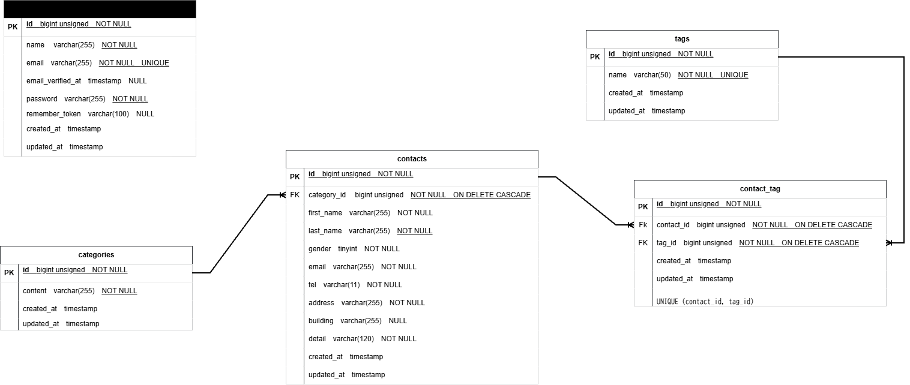

# お問い合わせフォーム

## アプリケーション概要

お問い合わせの登録や検索、削除、タグ管理ができるアプリケーションです。

## 環境構築

### Dockerの準備

```bash
git clone https://github.com/miuratouya021/contact-form-app.git
cd contact-form-app
```

### Composerのインストール

```bash
docker run --rm \
    -u "$(id -u):$(id -g)" \
    -v "$(pwd):/var/www/html" \
    -w /var/www/html \
    laravelsail/php82-composer:latest \
    composer install
```

### Laravelの環境構築

```bash
cp .env.example .env
```

.envのデータベース設定を以下に変更してください。

```env
DB_CONNECTION=mysql
DB_HOST=mysql
DB_PORT=3306
DB_DATABASE=laravel
DB_USERNAME=sail
DB_PASSWORD=password
```

```bash
./vendor/bin/sail up -d
./vendor/bin/sail artisan key:generate
./vendor/bin/sail artisan migrate --seed
./vendor/bin/sail npm install
./vendor/bin/sail npm run build
```

## 使用技術

- PHP 8.5.12
- Laravel 10.50.4
- MySQL 8.4
- Laravel Sail
- Laravel Fortify
- Docker
- Tailwind CSS

## 主な機能

- お問い合わせの入力・確認・登録
- ユーザー登録・ログイン・ログアウト
- お問い合わせ一覧表示
- お問い合わせ検索・絞り込み
- お問い合わせ詳細表示・削除
- タグの追加・編集・削除
- バリデーション
- ページネーション

## ER図



## URL

- お問い合わせ画面：http://localhost/
- ユーザー登録画面：http://localhost/register
- ログイン画面：http://localhost/login
- 管理画面：http://localhost/admin
- phpMyAdmin：http://localhost:8080

## テスト用アカウント

- メールアドレス：test@example.com
- パスワード：password

## テスト実行方法

```bash
./vendor/bin/sail artisan test
```
